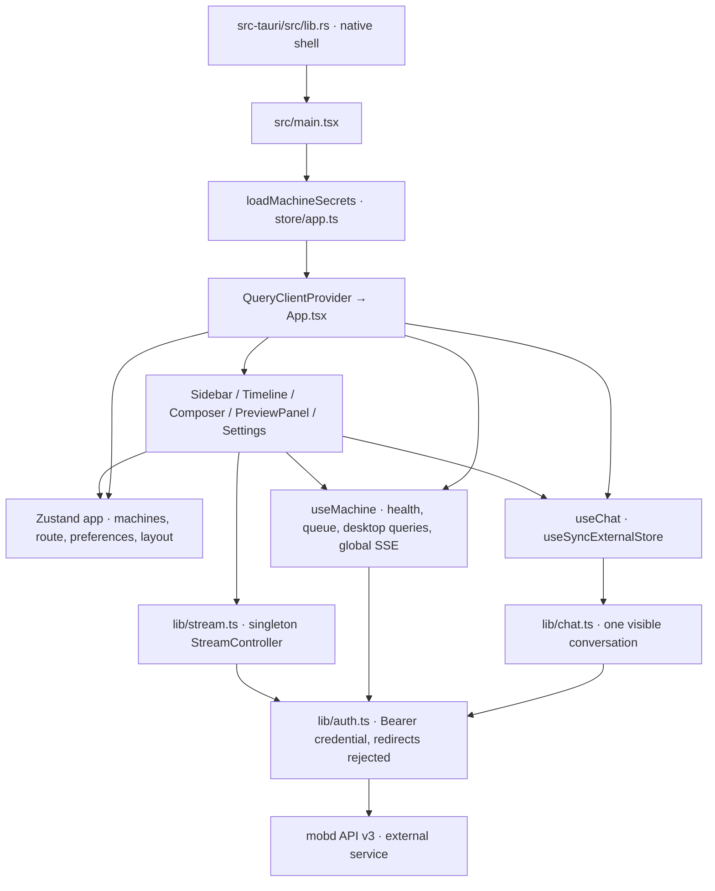
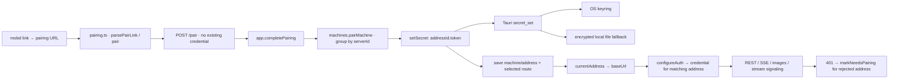
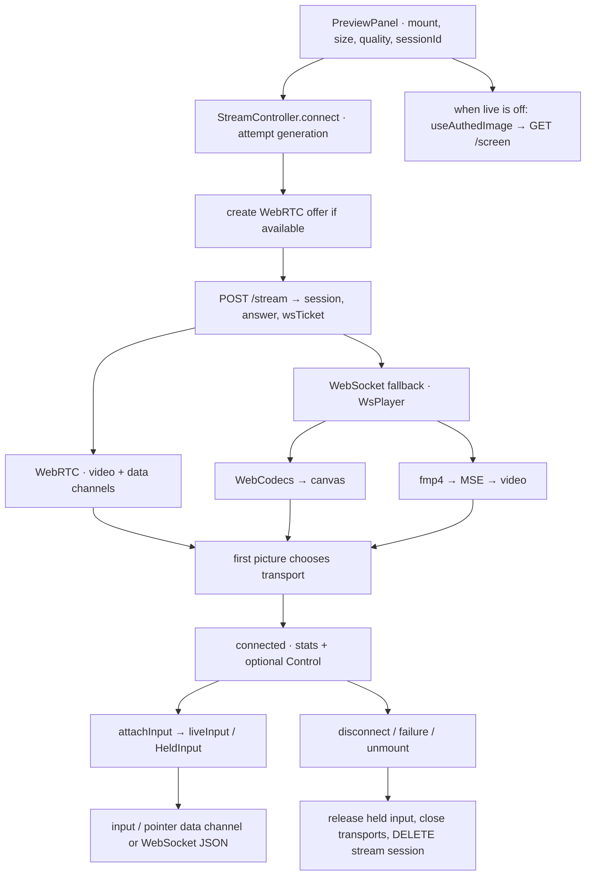

# Desktop code map

Source baseline: `a9b9b2a` (2026-10-28). This map describes the desktop client;
`mobd`, mobile clients and the website are separate repositories. Follow the
links to implementation before changing behavior; diagrams are an index, not an
API specification.

## Entry points and state ownership



| State | Owner / lifetime | Main consumers |
| --- | --- | --- |
| Machines, addresses, selected route, saved conversation, layout, theme | [store/app.ts](../src/store/app.ts), persisted as `mob.app` v7 | App, sidebar, settings, preview |
| Credentials | [lib/secrets.ts](../src/lib/secrets.ts) memory cache + [native storage](../src-tauri/src/secrets.rs) | Auth hooks installed by app store |
| Conversation list, visible history, tasks, activities, questions, task SSE cursor | [Chat](../src/lib/chat.ts), singleton exposed by [useChat](../src/hooks/useChat.ts) | Composer, sidebar, timeline, alerts, preview |
| Health, queue, desktops/resources, archived sessions, machine settings | TanStack Query; [useMachine](../src/hooks/useMachine.ts), sidebar, AgentsSection | Capability gates and server snapshots |
| Draft text / focus requests | [store/composer.ts](../src/store/composer.ts), memory | Composer, palette, new-chat actions |
| New-chat runner/model/effort drafts | `useApp.turnPrefs`, memory, cleared after successful creation | Composer |
| Live transport, render surface, control, stats | [StreamController](../src/lib/stream.ts), one active connection | PreviewPanel through `useStream` |
| Updater state / downloaded resource | [store/updates.ts](../src/store/updates.ts) | UpdateNotice, settings |

`Chat` mutates some objects in place. `useChat` signals changes through a version
counter; `Timeline` rebuilds its projection on every render. Query cache data and
Chat data are separate stores, connected explicitly by event handlers.

## Conversation and event flow

```mermaid
sequenceDiagram
  participant UI as App / Sidebar / Composer
  participant C as Chat
  participant D as mobd
  participant V as Timeline / alerts
  UI->>C: setMachine(id, base, savedSession)
  C->>D: GET /sessions
  C->>D: GET /sessions/{id} (when restoring)
  C-->>V: history + changed()
  UI->>C: submit(prompt, options)
  C->>D: POST /tasks
  D-->>C: Task acknowledgement + eventId
  C-->>UI: accepted: composer may clear
  C->>D: task SSE /tasks/{id}/events?after=cursor
  C->>D: recover history + refresh session list
  D-->>C: message / activity / question / usage / status
  C-->>V: changed() → useChat → buildTimeline
  UI->>C: steer / answer / cancel
  C->>D: POST task subresource
  D-->>C: terminal status event
  C->>D: close task SSE; recover final history
```

- [App](../src/App.tsx) attaches/detaches Chat when machine, address or pairing
  state changes and remembers the selected conversation after loading.
- [Composer](../src/components/composer/Composer.tsx) uploads images separately;
  new chats send runner/model/effort, existing chats use server conversation
  settings. Picker changes on existing chats call `PATCH /sessions/{id}`.
  [turnSettings](../src/lib/turnSettings.ts) supplies pure selection/edit helpers.
- `revision` invalidates old selection requests; `cursor` deduplicates task
  events; server `rev` enables incremental history (`?since=`).
  `mergeDetail` replaces changed turns and preserves the remaining turns.
  `recover` avoids overwriting newer task events with an older snapshot.
- Chat caches up to eight conversation details per machine. Opening a cached
  conversation displays it immediately, then refreshes it and subscribes if busy.
- [useMachineEvents](../src/hooks/useMachine.ts) owns a **second, global** SSE
  connection: session events update Chat summaries; queue/task events update
  queued-turn position/reason; settings events update Query and invalidate
  health; desktop/memory/disk events update the desktops Query cache.
  `reset` refreshes Chat and queue/desktops; `onopen` refetches queue/desktops.
- [EventStream](../src/lib/sse.ts) uses fetch so SSE can carry Authorization,
  resumes through `after`, backs off on retryable errors and stops on 401.
  Chat additionally restores snapshots after transport errors.
- [buildTimeline](../src/lib/timeline.ts) groups entries per turn, orders by time,
  folds three or more consecutive activities and replaces ask/approval tool
  steps with [QuestionCard](../src/components/timeline/QuestionCard.tsx).
  [useQuestionAlerts](../src/hooks/useQuestionAlerts.ts) handles title/toast alerts.

## Pairing, routes and native storage



- [machines.ts](../src/lib/machines.ts) is the pure machine/address model. A
  machine can have multiple separately paired addresses; switching is explicit.
  Never assume one credential covers every address of the same server.
- Startup loads credentials **before mounting React**. The app store publishes
  pairing state after the credential write succeeds. Browser development keeps
  credentials in memory only.
- [migrate.ts](../src/store/migrate.ts) migrates persisted app versions; native
  [secrets.rs](../src-tauri/src/secrets.rs) owns keyring and encrypted fallback.
- [AgentsSection](../src/components/settings/AgentsSection.tsx) edits the
  selected machine's server settings, including inactive machines. Saving uses
  `rev`; `settings_changed` reloads settings. Relaxing agent permissions has a
  confirmation in the existing UI.
- [native lib.rs](../src-tauri/src/lib.rs) registers credential/clipboard IPC,
  updater/process plugins and Linux WebKit media settings. Task execution and
  desktop capture belong to mobd, not Rust in this repository.

## Desktop stream and input



- [PreviewPanel](../src/components/preview/PreviewPanel.tsx) owns connection
  lifecycle. Closing the panel unmounts it. Changing machine disconnects;
  conversation changes reconnect when `sessionDesktops` is supported. A new
  chat without a desktop cannot show a session-specific picture.
- [stream.ts](../src/lib/stream.ts) guards obsolete asynchronous work with
  `attempt`. WebRTC normally gets 5 s before WebSocket fallback; remembered
  WebSocket machines race after 1 s when WebCodecs is available. MSE shares the
  video element and does not race beside WebRTC. First picture selects the
  transport and closes the other candidate.
- [wsVideo.ts](../src/lib/wsVideo.ts) parses H.264 messages, acknowledges frames,
  requests keyframes and handles decoder recovery. [fmp4.ts](../src/lib/fmp4.ts)
  produces MP4 init/media segments for MSE.
- Resize uses `streamResize` control messages (150 ms debounce), otherwise
  reconnects (600 ms). Quality changes reconnect. Only the expanded view
  controls input; collapse, blur and leaving Control release held keys/buttons.
- [liveInput.ts](../src/lib/liveInput.ts) normalizes letterboxed coordinates,
  wheel deltas and modifier keys; [ime.ts](../src/lib/ime.ts) protects composition
  input. [platform.ts](../src/lib/platform.ts) handles client platform differences.
- [useAuthedImage](../src/hooks/useAuthedImage.ts) loads authenticated blobs,
  reuses ETags and revokes object URLs. Snapshots poll every 4 s while visible;
  [timeline geometry](../src/lib/timeline.ts) drives agent click markers.

## Symptom → first files → verification

| Symptom / task | First implementation files | Existing checks |
| --- | --- | --- |
| Conversation switching, recovery, duplicate/missing messages, cancellation | `lib/chat.ts`, `hooks/useChat.ts`, `App.tsx` | `src/lib/chat.test.mjs` |
| Sidebar live status, queue, sleeping desktops, resource pressure | `hooks/useMachine.ts`, `lib/desktops.ts`, `components/sidebar/Sidebar.tsx` | `desktops.test.mjs`, `sse.test.mjs`, `chat.test.mjs` |
| Timeline ordering/grouping, click position | `lib/timeline.ts`, `components/timeline/*` | `timeline.test.mjs` |
| Send, retry, runner/model/effort, IME | `Composer.tsx`, `Timeline.tsx`, `lib/turnSettings.ts`, `lib/ime.ts` | `turnSettings.test.mjs`, `ime.test.mjs`, `chat.test.mjs` |
| Pairing, selected address, unauthorized requests | `lib/pairing.ts`, `lib/machines.ts`, `lib/auth.ts`, `store/app.ts` | `pairing.test.mjs`, `machines.test.mjs`, `store/migrate.test.mjs` |
| Live view, input, WebSocket decode/MSE | `PreviewPanel.tsx`, `lib/stream.ts`, `lib/wsVideo.ts`, `lib/fmp4.ts`, `lib/liveInput.ts` | `stream.test.mjs`, `wsVideo.test.mjs`, `fmp4.test.mjs`, `liveInput.test.mjs`, `view.test.mjs` |
| Credential backend / native clipboard | `src-tauri/src/lib.rs`, `src-tauri/src/secrets.rs`, `lib/secrets.ts` | Rust tests (`cargo test --locked` from `src-tauri`) |
| Updates / release artifacts | `store/updates.ts`, `.github/release/*`, `.github/workflows/*` | `store/updates.test.mjs`, `make release-test` |

Run focused tests with `node --test <test-file>`. Full frontend checks:
`make check` (logic tests, typecheck, release tests), then `npm run build`.
Pure logic tests use Node's TypeScript stripping; most React interactions still
need UI validation. See [UI design](ui.md), [stream details](desktop-streaming.md),
[credential storage](credential-storage.md), [ADR 0009](adr/0009-app-frontend-react.md)
and [release setup](releases.md) for deeper constraints.
