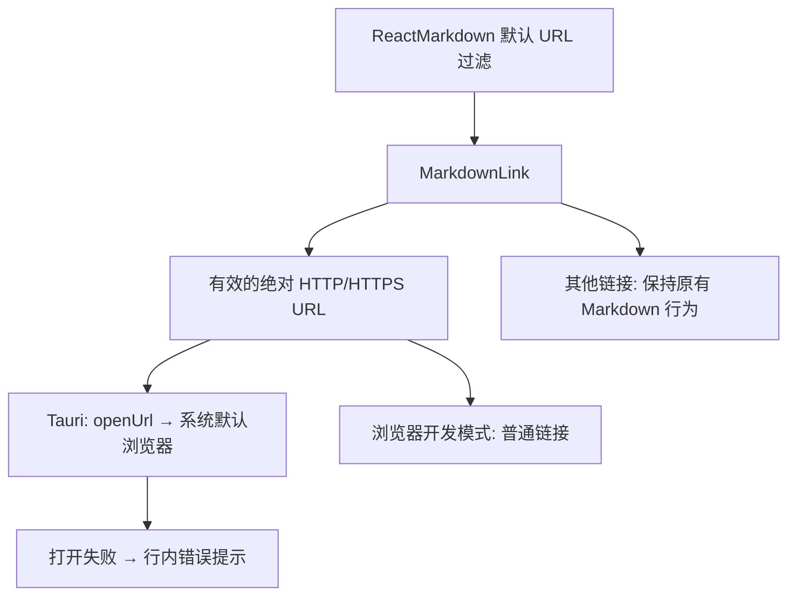

# Issue #2：聊天回复中的网页链接

状态：按用户最新要求，仅保留网页链接修复；本机文件操作已移除。
Issue：[聊天回复中的外部链接和本地文件链接点击无反应](https://github.com/xrdavies/mob/issues/2)。
代码导航：[模块与数据流图](../code-map.md)。

## 问题与范围

原有 Markdown 链接只有 `target="_blank"`，没有在 Tauri 中显式调用系统浏览器，
也没有打开失败的反馈。修复 HTTP/HTTPS 网页链接的打开行为。

本机文件解析、文件操作弹窗、复制文件路径、系统文件打开及文件管理器定位均已移除。
文件链接恢复原有 Markdown 行为；保留 react-markdown 默认的 URL 过滤策略。
办公室文件远程预览需要另行设计 mobd 附件导出和认证下载接口，当前未实现。

## 实现



- `Markdown.tsx` 通过 `MarkdownLink` 渲染链接，不自定义 `urlTransform`。
- `MarkdownLink.tsx` 只对 Tauri 中有效的绝对 HTTP/HTTPS 地址阻止默认导航并调用
  `@tauri-apps/plugin-opener.openUrl`。拒绝将带控制字符、登录信息或非法 URL 交给 opener。
- Rust 注册 opener，关闭插件自动接管链接的行为。capability 仅允许 HTTP/HTTPS
  URL；没有本机文件 IPC，也没有前端文件打开/定位权限。
- 浏览器开发模式和其他链接保持原有 anchor 行为。
- “系统默认浏览器”指运行 Mob 客户端的机器：例如从另一台 Mac 连接 M4003，
  网页应在另一台 Mac 打开，不在 M4003 上打开，也不通过 mobd 执行远程打开。

## 验证与人工验收

组件测试使用实际 Markdown 渲染与 DOM 点击，检查完整 Apple URL、HTTP 地址、
表格内多个项目链接、打开失败反馈、浏览器模式以及非网页链接不调用原生接口。
表格链接测试禁止网络请求，确认点击只调用客户端的原生 opener，不依赖远程机器。
执行 `make check`、前端构建、`cargo test --locked` 和 Tauri app 构建。

2026-11-01 核对官方 `xrdavies/mob` 的 `v0.4.0` 标签：该版本仍使用
`target="_blank"`，没有注册 opener，也没有本修复的 `MarkdownLink`。
同一表格链接的 DOM 点击回放在该标签上没有产生原生浏览器调用，在本地 `main`
上产生 `plugin:opener|open_url` 调用。发布版本不能仅凭本地源码已有修复判断；
需要在客户端机器安装包含上述实现的构建，仅更新 M4003 的 mobd 无效。

在生成的 `Mob.app` 中点击下面的聊天链接，应由系统默认浏览器打开：

```markdown
[Apple 真机运行说明](https://developer.apple.com/documentation/Xcode/running-your-app-on-simulated-or-physical-devices)
```

macOS 已在前次原生自测中验证 Apple 网页通过默认浏览器 Chrome 打开。
Windows/Linux 的系统浏览器启动仍需对应平台验收。
